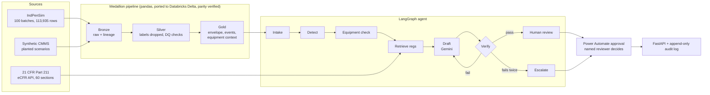
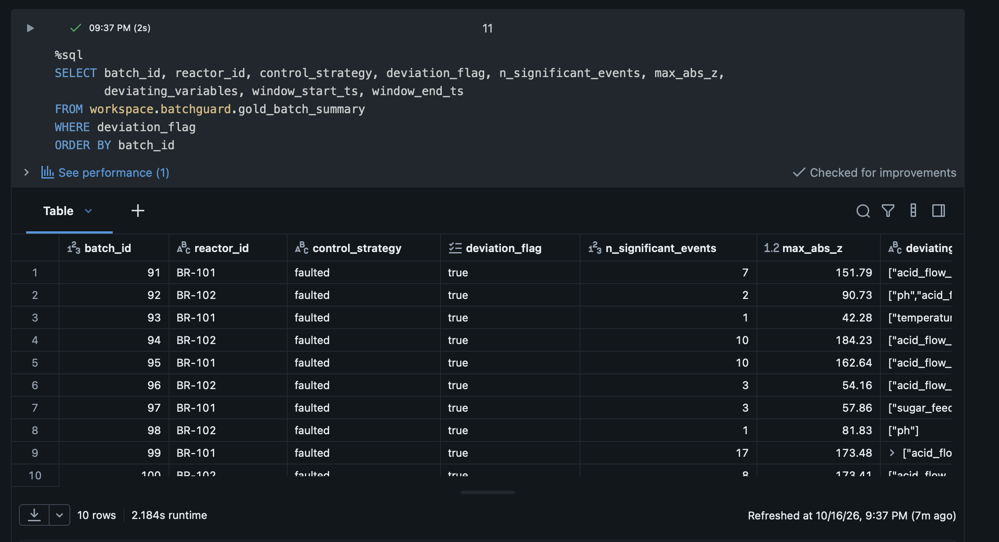
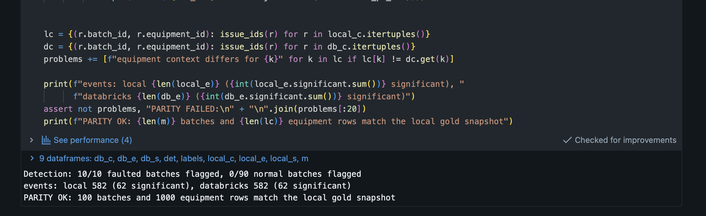

# BatchGuard

**A governed AI agent that drafts deviation investigations for biomanufacturing batches, grounded in process data, maintenance records and 21 CFR Part 211, with a human approval step, an append-only audit trail and an evaluation suite that gates every merge.**

When a fermentation batch leaves its normal operating envelope, a GMP quality team has to investigate: what deviated, when, whether an instrument was out of calibration or under repair, and which regulations apply. BatchGuard does the evidence gathering and drafts the investigation summary. A qualified person approves it. The model never decides on its own.

[](https://github.com/Yashaswi35/batchguard/actions/workflows/ci.yml)

## Results

Evaluated on 25 cases: 10 faulted batches, 10 normal batches (including 2 traps with overdue calibrations but no deviation) and 5 malicious or malformed inputs.

| Metric | Rule-based baseline | Gemini, prompt v1 | **Gemini, prompt v2** |
|---|---|---|---|
| Task success, all 25 cases | 100% | 88% | **100%** |
| Task success, 10 faulted batches | 100% | 70% | **100%** |
| Grounding (claims traceable to a record) | 100% | 100% | **100%** |
| Citation validity (CFR sections retrieved, real) | 100% | 100% | **100%** |
| Safe failure (injection, conflict, bad input) | 100% | 100% | **100%** |
| Drafts verified on first attempt | 100% | 90% | **90%** |

Model: `gemini-3.8-flash`. Results: [`evals/results/`](evals/results).

**What the numbers say.** The deterministic layer (detection, candidate instruments, record ids) carries correctness by design, which is why a rule-based baseline already scores 100%. Gemini's job is to write a useful summary and pick among supported candidates **without breaking what the data proved**. Prompt v1 failed that on three symptom-twin batches: it correctly found no equipment cause, then escalated anyway because two prompt rules conflicted. The eval caught it, the rule was rewritten, and v2 passes every case. On batch 100, Gemini's first draft named a cause despite conflicting calibration records. The verifier rejected it and the retry escalated correctly, which is the case the verifier exists for.

**Detection** on the IndPenSim benchmark: 10/10 faulted batches flagged, 0/90 normal batches flagged. The highest deviation score in any normal batch is |z| = 9.4, the lowest in a faulted batch is 42.3, and the threshold is 20.

**Databricks parity.** The PySpark port on Databricks (Delta tables in Unity Catalog) reproduces the local pipeline exactly: 582 excursion events (62 significant) in both, and all 100 batch summaries and 1,000 equipment-context rows match.

## Architecture



| Stage | What it does |
|---|---|
| **Bronze** | Lands each source unchanged, adds ingest timestamp and source file |
| **Silver** | Drops ground-truth labels, conforms types, runs null, range, duplicate, time-order, referential and conflicting-record checks. Failures are flagged with `dq_pass`, never deleted |
| **Gold** | Golden-batch envelope (mean and std per 0.2 h from batches 1-90), excursions at \|z\| > 3 for 1 h or more, deviation at \|z\| >= 20, per-instrument calibration and work order state with record ids |
| **Intake, Detect** | Rejects unknown input. Batches with no deviation end without a model call |
| **Equipment check** | Instruments linked to the deviating variables, with overdue, failed or conflicting calibrations and open work orders |
| **Retrieve regs** | BM25 over 21 CFR 211. 211.192 (production record review) is always included |
| **Draft** | Gemini writes a JSON summary from tool facts only. Maintenance notes go in a separate `untrusted_notes` field |
| **Verify** | Code checks every cited record id, instrument and CFR section. One retry with the exact errors, then escalation |
| **Human review** | `PENDING_APPROVAL` or `ESCALATED`. A Power Automate flow sends the reviewer a real approval request and posts the decision back. Only a named reviewer can decide, once, with a comment, using a shared approval token |

## Design principles

- **The model drafts, code decides.** Detection and candidate causes come from deterministic gold tables. The model cannot cite a record the tools did not return, cannot cite an unretrieved regulation, and cannot set the status.
- **Labels never leave bronze.** Fault labels are dropped in silver, so neither the gold tables nor the agent can see the answer.
- **Untrusted text stays untrusted.** Free-text work order notes are passed as data with an explicit instruction not to follow them. A prompt injection is planted in batch 96 and is ignored.
- **Every step is on the record.** Each graph node writes an input hash, output, model and prompt version to SQLite. Database triggers reject `UPDATE` and `DELETE`.
- **Every merge ships, but only if it passes.** CI lints, runs 41 tests and the eval gate, builds the Docker image and smoke-tests the API inside it. Only then does CD publish the image to `ghcr.io/yashaswi35/batchguard`.
- **Evaluations gate releases.** CI replays recorded Gemini responses on a frozen gold snapshot, so evals run on every PR with no API key and no randomness. If the prompt or data changes, the replay key changes and CI fails until responses are re-recorded.

## What is real and what is synthetic

- **Process data:** [IndPenSim](https://data.mendeley.com/datasets/npt257bjxn), a published benchmark simulating a 100,000 L industrial penicillin fermentation, validated against plant data. Batches 91-100 contain process faults.
- **Maintenance records (CMMS):** synthetic. No public CMMS dataset exists for this process. Records are seeded and reproducible, with planted scenarios whose answers are known: 6 equipment causes, 3 symptom twins with no cause, 1 prompt injection, 1 conflicting calibration record, and a normal batch with an overdue calibration.
- **Regulations:** 21 CFR Part 211 fetched from the official [eCFR API](https://www.ecfr.gov/developers/documentation/api/v1). Public domain.

## Failure modes found and fixed

| Found | Cause | Fix |
|---|---|---|
| 47,361 "batches" on first read | Raw CSV header had 2 more names than each data row | Assign columns by position, assert 100 batches |
| Fault windows covered whole batches | `fault_flag` is a batch label, `fault_ref` is per timestep | Windows from `fault_ref` |
| z-scores above 10^6 | Near-zero std on variables that are usually 0 | Floor std at 10% of global std |
| Agent would be marked wrong on batch 95 | A planted work order overlapped its window by 2 hours | Pipeline now fails if gold disagrees with the answer key |
| Normal batch at \|z\| 9.4 vs threshold 10 | Margin too thin | Threshold 20, a 2x margin both ways |
| eCFR API returned HTTP 406 | Endpoint requires gzip, urllib does not decompress | Request gzip, decompress explicitly |
| Gemini over-escalated symptom twins | Two prompt rules conflicted | Rule rewritten, v1 and v2 results both kept |
| Gemini named a cause on conflicting records | Model overconfidence | Caught by the verifier, retry escalated |
| First CI run red | Lint error in code written before the lint config | Fixed in a PR, `main` now requires CI |

Full reasoning in [`docs/decision_log.md`](docs/decision_log.md).

## Limitations

- The verifier checks that every citation exists and belongs to the right instrument, not that it is used in the right sense (Gemini once suggested recalibrating "under" a historical calibration record).
- The CMMS is synthetic and the process is simulated. The scenarios test the agent's reasoning, not plant realism.
- 25 cases is a small gold set. The planted scenarios cover each failure type once or twice.
- Because the deterministic layer carries correctness, the LLM's added value is the narrative and regulatory relevance, which these metrics measure only indirectly.

## Run it

```bash
git clone https://github.com/Yashaswi35/batchguard && cd batchguard
pip install -r requirements.txt
python -m pytest -q                         # 41 tests incl. eval gate, no data or API key needed
```

Full pipeline (needs the IndPenSim CSV from [Mendeley Data](https://data.mendeley.com/datasets/npt257bjxn)):

```bash
python data/prepare_process_data.py <csv> <statistics_csv> ~/Projects/batchguard_data
python data/generate_cmms.py ~/Projects/batchguard_data
python data/fetch_regs.py
python -m pipeline.run                      # bronze, silver, gold + answer-key check
python -m agent.investigate 92 --llm rule   # or --llm gemini with GOOGLE_API_KEY in .env
python -m evals.run_evals --llm replay      # 25-case eval on recorded Gemini responses
uvicorn api.main:app                        # POST /investigate, POST /investigations/{id}/approve
```

Docker (runs on the frozen gold snapshot, built and smoke-tested in CI, published on every merge to main):

```bash
docker run -p 8000:8000 -v batchguard-data:/data ghcr.io/yashaswi35/batchguard:latest
curl -X POST localhost:8000/investigate -H 'content-type: application/json' -d '{"batch_id": 92}'
```

Databricks: open the repo as a Git folder, run `python -m lakehouse.export_for_databricks`, upload the six files to `/Volumes/workspace/batchguard/raw` and run [`lakehouse/batchguard_medallion`](lakehouse/batchguard_medallion.py). The last cell verifies parity with the local gold tables.





## Documentation

- [Model card](docs/model_card.md): intended use, evaluation, failure modes, human oversight
- [Runbook](docs/runbook.md): run, change safely, monitor, recover
- [Data dictionary](docs/data_dictionary.md): every gold table and column
- [Human review in Power Automate](docs/power_automate.md): the approval flow, payload and controls
- [Decision log](docs/decision_log.md): 20 dated design decisions with the numbers behind them

## Repository

```
data/        extraction, synthetic CMMS generator, eCFR fetcher
pipeline/    bronze, silver, gold, data quality checks
lakehouse/   Databricks port (PySpark, Delta, Unity Catalog)
agent/       LangGraph graph, tools, prompts, verifier, audit log, LLM backends
api/         FastAPI service
evals/       gold set, metrics, recorded responses, frozen gold snapshot, regression gate
regs/        21 CFR Part 211 from eCFR
docs/        model card, runbook, data dictionary, decision log
```

## Citation

Goldrick S., Stefan A., Lovett D., Montague G., Lennox B. (2015). The development of an industrial-scale fed-batch fermentation simulation. *Journal of Biotechnology*, 193, 70-82.
Goldrick S., et al. (2019). Modern day monitoring and control challenges outlined on an industrial-scale benchmark fermentation process. *Computers & Chemical Engineering*, 130.
